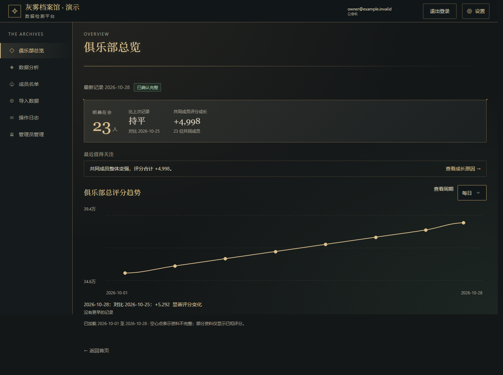
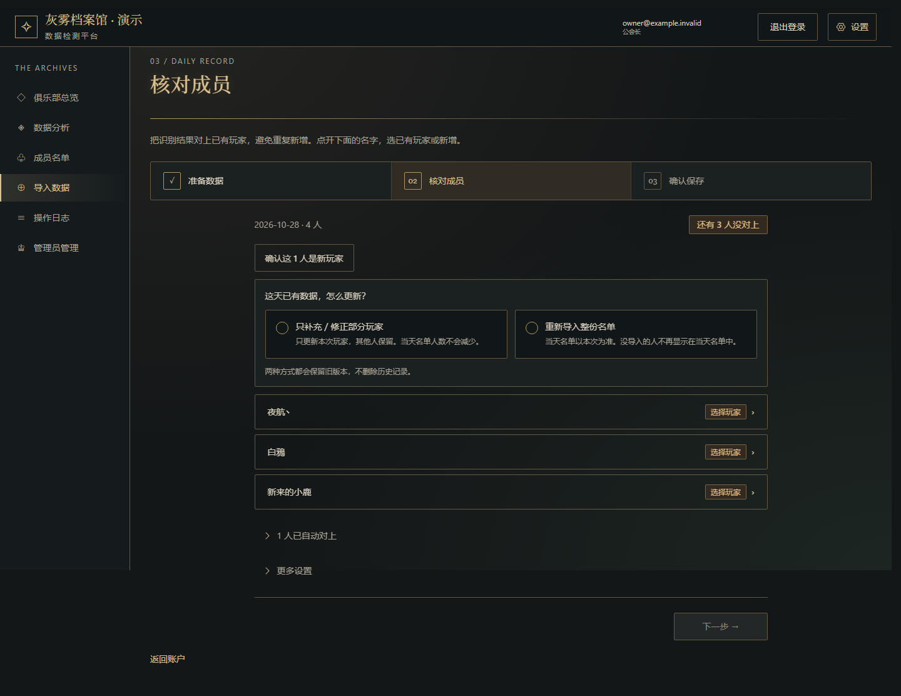
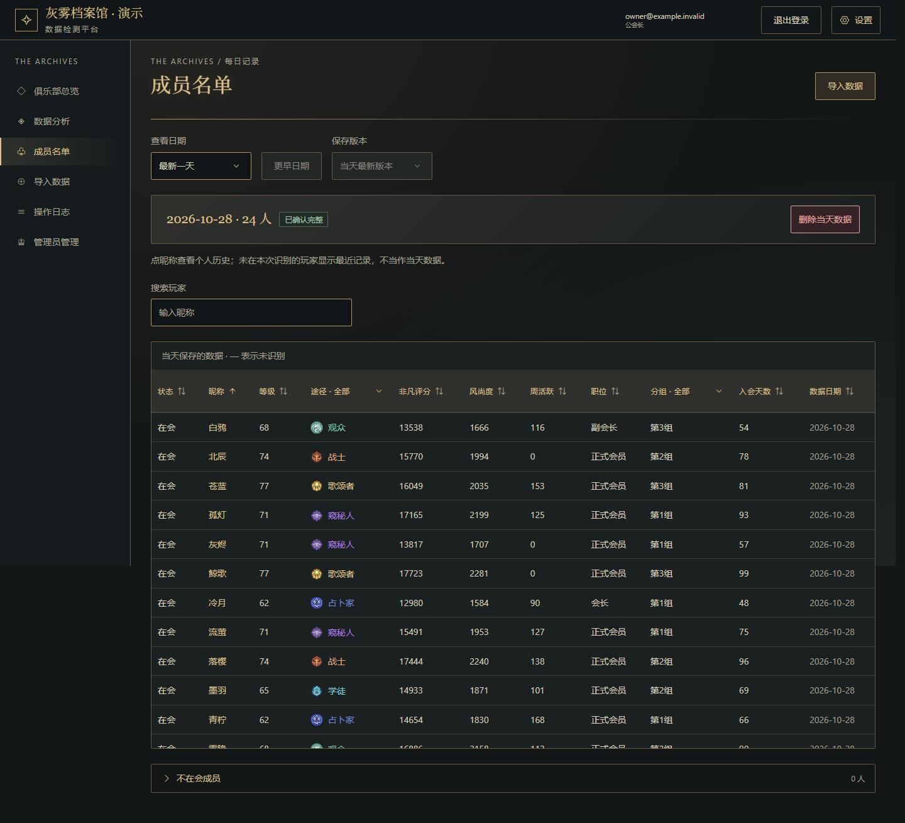
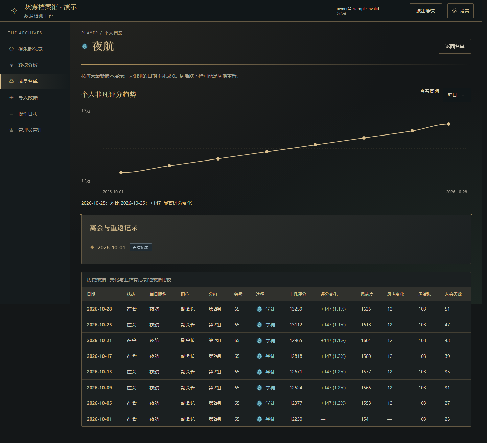
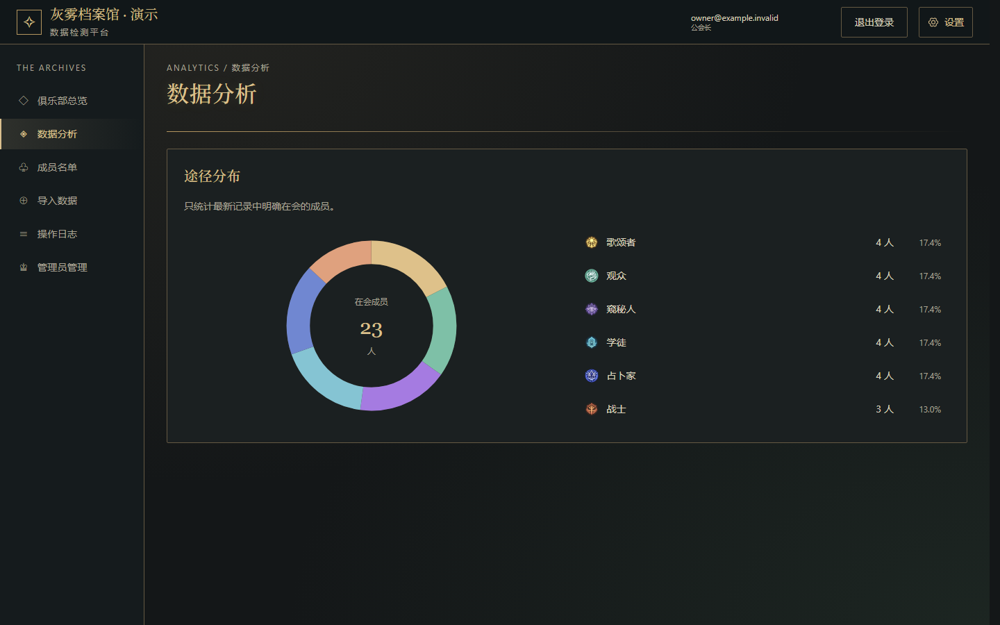
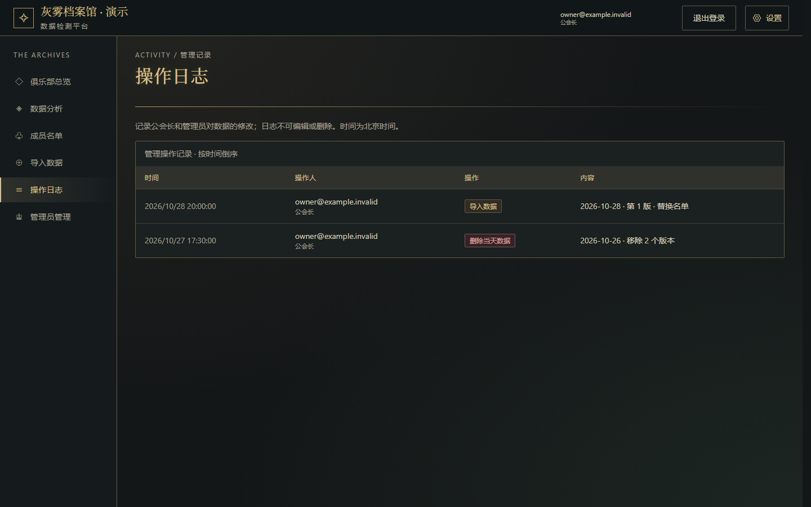

# SquirrelAPI

个人长期项目：主站 [squirrelapi.org](https://squirrelapi.org) 与俱乐部管理应用 [club.squirrelapi.org](https://club.squirrelapi.org)。

## Club 简介

Club 是一个游戏俱乐部的成员管理与数据分析系统。管理员把游戏内的成员截图交给外部 AI 转成 JSON，导入后系统负责识别身份、保存每日快照，并据此追踪成员变化和成长。

**主要功能**

- **JSON 导入与身份匹配**：按准确昵称、已确认别名和编辑距离推荐候选，不确定的身份必须人工确认，绝不自动合并相似昵称。同一天可选择合并或替换，旧版本全部保留，可追溯。
- **成员与出勤**：根据完整名单判断在会、暂离和确认离会，玩家重新出现时沿用原身份。
- **历史与分析**：个人历史时间线、分数趋势、俱乐部成长排名和途径分布。
- **审计日志**：所有写操作都记录操作者和变更内容，日志只能追加，不能修改或删除。

**权限与安全设计**

- 权限统一由数据库函数 `can()` 判断，所有业务表启用 RLS。客户端没有直接写表的权限，写入只能通过带权限检查的事务函数完成。
- 角色分为 Owner、Admin、联盟负责人、平台管理员和 Super Admin，按多层规则叠加（平台默认、俱乐部默认、个人设置、角色上限），每层的决策都可以解释和测试。
- Super Admin 需要 TOTP 双重验证，并且设备必须经过单独确认。退出登录或移除设备后，权限立即失效。
- Worker 只使用 publishable key 加用户自己的 token，登录状态保存在 HttpOnly Cookie 中，并检查请求来源。
- 写操作支持幂等重试，用版本号检测并发冲突。

### 截图

> Club 需要登录才能访问，以下截图使用虚构演示数据，不含真实玩家信息。

| 俱乐部总览与评分趋势 | 导入：核对成员身份 |
| :---: | :---: |
|  |  |
| **成员名单** | **个人档案与历史** |
|  |  |
| **途径分布** | **操作日志** |
|  |  |

## 技术栈

- **前端**：Next.js + TypeScript（静态导出），Club 使用 Tailwind v4 + shadcn/ui + Radix + Motion
- **运行与托管**：Cloudflare Workers（静态资源 + Worker 接口）
- **数据库与认证**：Supabase（PostgreSQL、RLS）
- **工程**：pnpm Monorepo、Playwright、GitHub Actions

## 目录结构

```
apps/
  web/     主站
  club/    Club 应用（导入、成员、历史、分析、管理）
supabase/  迁移与 SQL 测试
tests/     单元、浏览器与集成测试
scripts/   环境、测试与 CI 脚本
docs/      需求、架构、决策与测试文档
```

## 快速开始

需要 Node.js 24、pnpm 12.15.0。在仓库根目录打开 PowerShell：

```powershell
. ./scripts/env.ps1          # 每个新终端先载入
pnpm install --frozen-lockfile
pnpm dev                     # 主站 http://localhost:3000
pnpm club:preview            # Club 本地 HTTPS Worker（8788）
```

本地密钥放在被忽略的 `.dev.vars`，只使用 publishable key，切勿提交 service-role key 或密码。

## 常用命令

| 命令 | 用途 |
| :--- | :--- |
| `pnpm check` | ESLint、类型检查、构建 |
| `pnpm test:affected` | 按变更范围运行检查（日常使用） |
| `pnpm test:unit` | Node.js 单元测试 |
| `pnpm test:e2e` | Playwright 浏览器流程 |
| `pnpm test:db` | 隔离 PostgreSQL 上的 SQL 测试 |
| `pnpm test:integration` | 本地 Supabase + HTTPS Worker 真实集成测试 |
| `pnpm test:full` | 完整回归（重要发布前） |

测试绝不连接正式 Supabase。详情见 [docs/TESTING.md](docs/TESTING.md)。

## 部署

推送到 `main` 后，GitHub Actions 运行受影响的检查，全部通过才自动发布有改动的应用；纯文档、测试、脚本改动不发布。数据库迁移始终人工执行。

## 文档

- [架构](docs/ARCHITECTURE.md) · [Club 架构](docs/CLUB_ARCHITECTURE.md)
- [需求](docs/REQUIREMENTS.md) · [Club 需求](docs/CLUB_REQUIREMENTS.md)
- [决策记录](docs/DECISIONS.md) · [测试](docs/TESTING.md) · [性能](docs/PERFORMANCE.md)
- [Agent 规则](AGENTS.md)

带日期的历史验证与部署记录见 Git 历史和 `docs/`。
