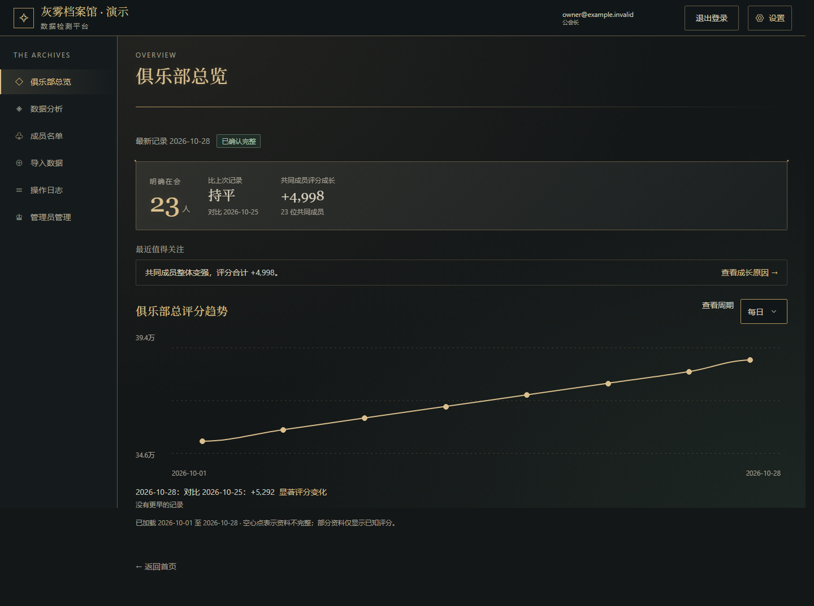
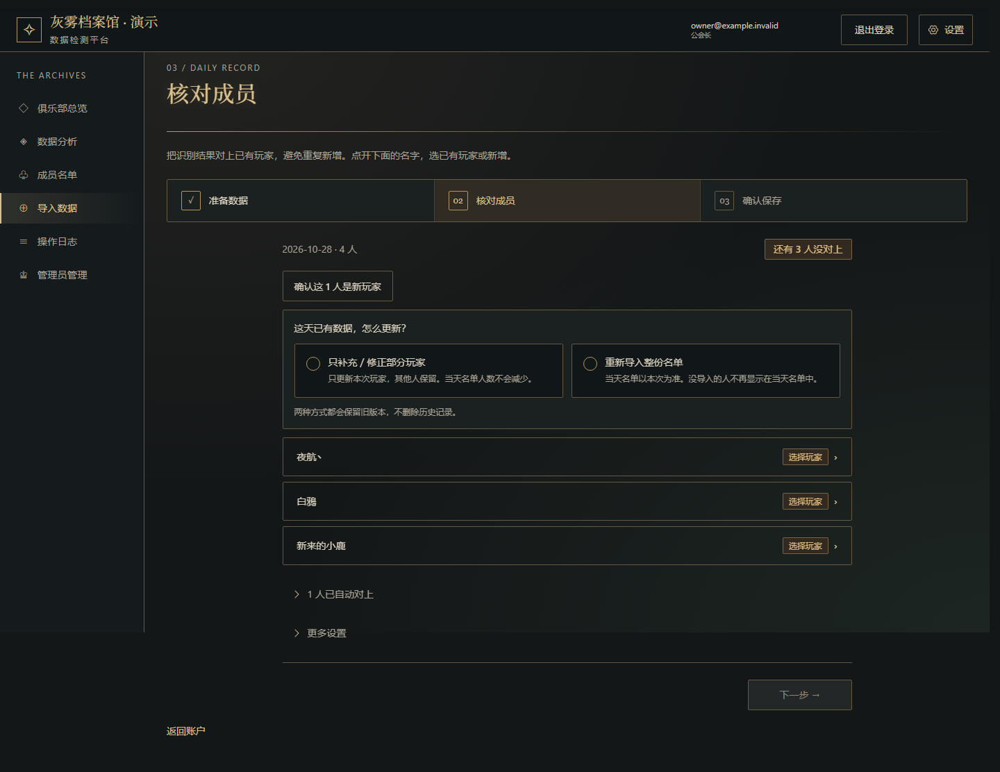
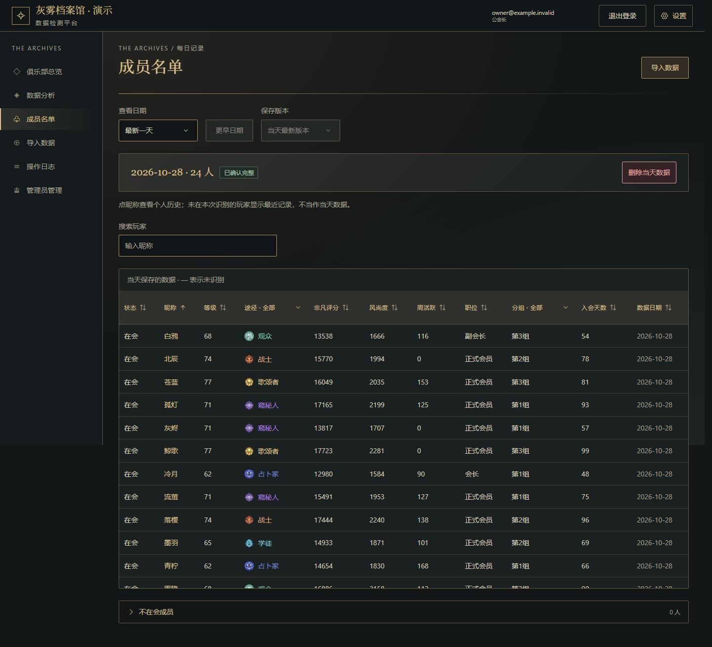
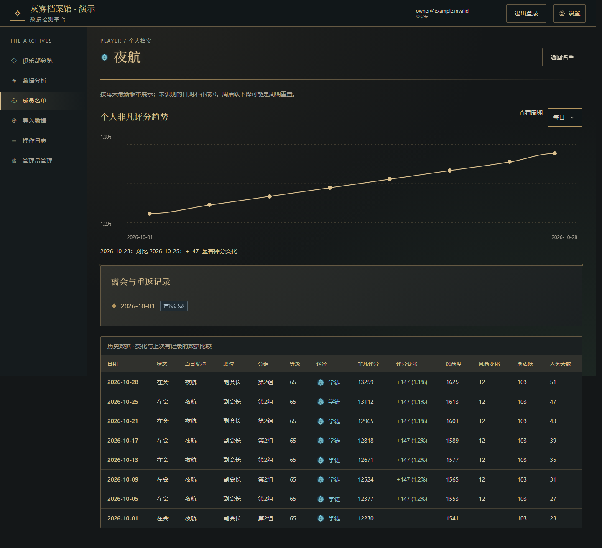
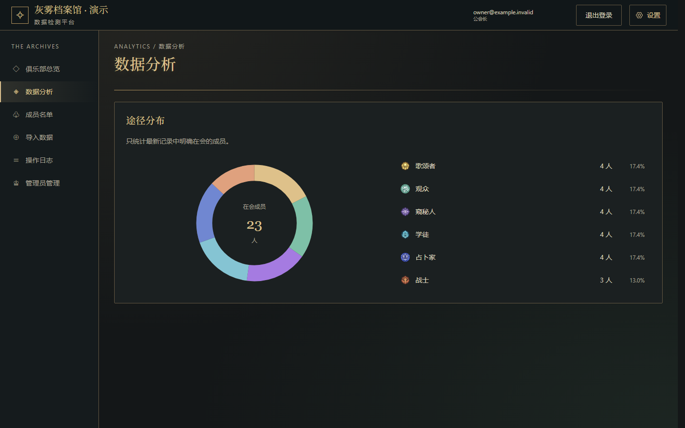
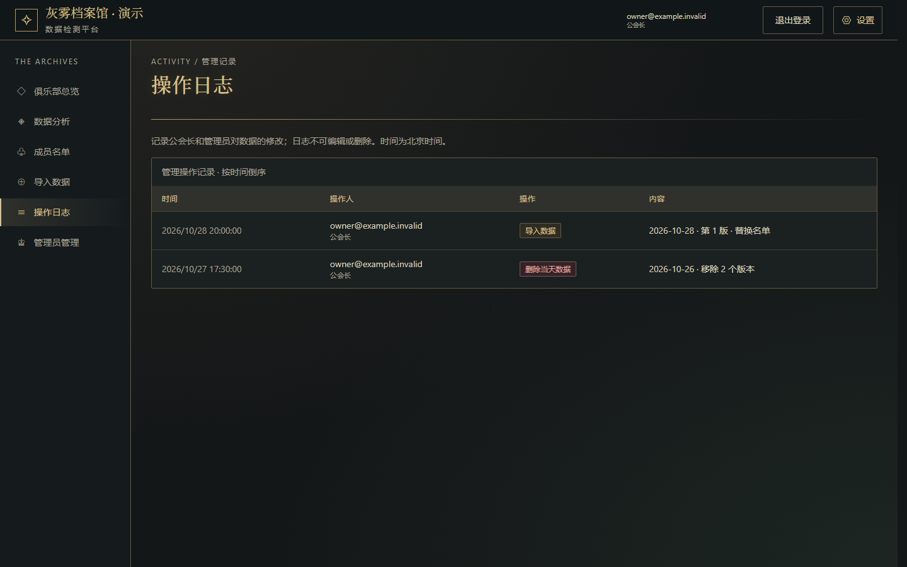

# SquirrelAPI

[English](README.md) | 中文

一个网络游戏公会的成员管理与数据分析 Web 应用，以及一个个人网站。

- **Club 应用：** [club.squirrelapi.org](https://club.squirrelapi.org)（需要登录，见下方截图）
- **个人网站：** [squirrelapi.org](https://squirrelapi.org)

## 项目简介

我管理着一个约 80 人的游戏公会。游戏里的成员名单只能在游戏画面中查看，谁加入、谁离开、谁在变强，以前只能靠截图和手工表格记录。

Club 把这些截图变成按日期保存的历史记录。外部 AI 先把截图识别成 JSON，Club 再把每一行对应到已知玩家，保存每日快照，并展示成员变化和评分成长。

目前有两个人在使用：我和另一位公会管理员，系统里保存的是我们公会约 80 名成员的数据。整个项目由我独立设计和开发，开发过程中使用 AI 编程助手作为工具（规则见 [AGENTS.md](AGENTS.md)）。

## 截图

所有截图均使用虚构的演示数据。

| 总览与评分趋势 | 导入：核对成员身份 |
| :---: | :---: |
|  |  |
| **成员名单** | **个人档案与历史** |
|  |  |
| **途径分布** | **操作日志** |
|  |  |

## 技术亮点

- **导入时的身份匹配。** 昵称不唯一，而且经常改。系统先按准确昵称匹配，再按已确认的别名匹配。相近的昵称（编辑距离，忽略装饰符号）只作为推荐。不确定的行必须人工确认，绝不自动合并相似昵称。
- **有版本、可追溯的数据。** 同一天重新导入可以选择合并或替换，但旧版本、原始 JSON 和每一次身份确认都会保留。只有在确认完整的名单中缺席，才会判定为离会。
- **在数据库层做权限控制。** 所有权限判断都由一个 Postgres 函数 `can()` 完成，RLS 和写入函数共用这一套逻辑。客户端不能直接写表，写入只能通过事务函数完成：函数在加锁后重新检查权限，支持安全重试，并用版本号拒绝过期的预览。
- **最小权限的 API。** Cloudflare Worker 只使用 publishable key 加用户自己的 token，登录状态保存在 HttpOnly Cookie 中，并拒绝跨来源请求。
- **超级管理员的双重验证。** 平台级权限需要来自已单独确认设备的 TOTP 会话，退出登录或移除设备后立即失效。所有变更都记录在只能追加的审计日志中。

## 技术栈

- **前端：** Next.js（静态导出）、TypeScript；Club 使用 Tailwind CSS v4、shadcn/ui、Radix 和 Motion
- **后端：** Cloudflare Workers
- **数据库与认证：** Supabase（PostgreSQL、Row Level Security、支持 TOTP 的 Auth）
- **工具：** pnpm monorepo、Playwright、GitHub Actions

## 工程实践

- **CI/CD：** 每次推送到 `main`，只运行受这次改动影响的检查。只有应用的发布文件有改动、并且所有检查都通过时，才会部署该应用。文档和测试的改动不会触发部署。
- **测试：** 单元测试、Playwright 浏览器测试、在临时 PostgreSQL 上运行的 SQL 测试，以及在本地 Supabase 环境中使用合成数据的集成测试。任何测试都不会连接正式数据库。
- **数据库迁移：** 用原始迁移文件手动执行，执行后用校验和核对。正式数据库的版本与最新迁移一致之前，Club 不会部署。

## 后续计划

- 活动记录：长期记录公会活动的参与情况。
- 活动报名：成员提前报名，管理员可以预先知道活动会有多少人参加。

## 仓库结构

```
apps/web     个人网站
apps/club    Club 应用（前端 + Worker）
supabase/    数据库迁移与 SQL 测试
tests/       单元、浏览器与集成测试
docs/        需求、架构、决策与测试文档
```

本地开发与测试见 [docs/TESTING.md](docs/TESTING.md)，架构见 [docs/ARCHITECTURE.md](docs/ARCHITECTURE.md)。
